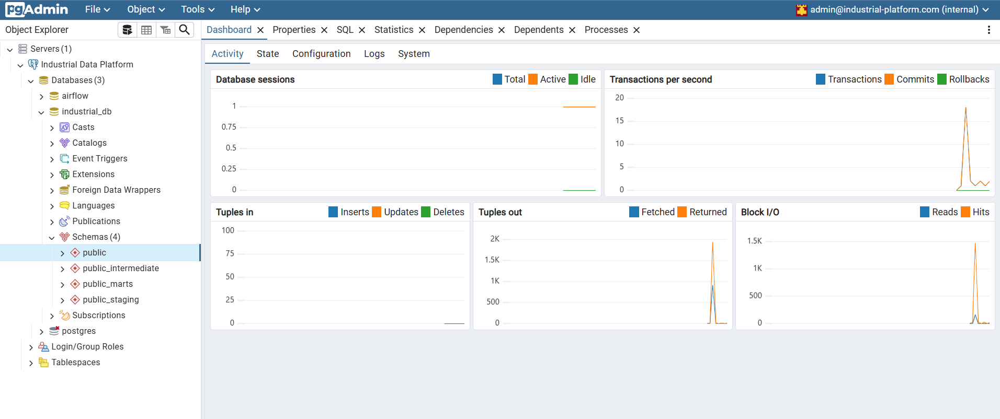
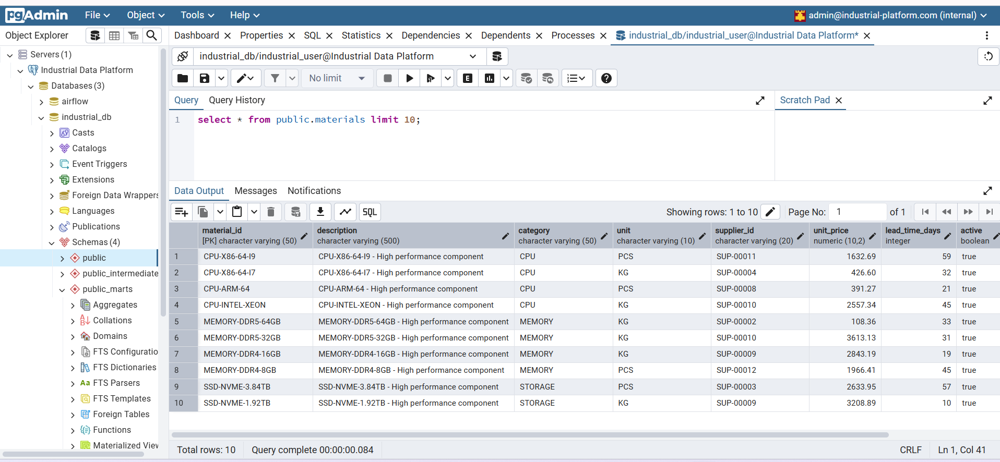
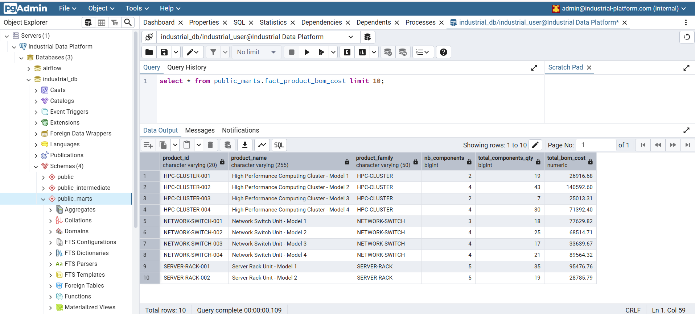
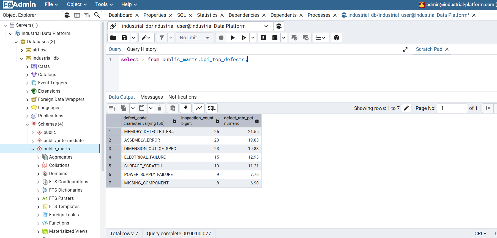
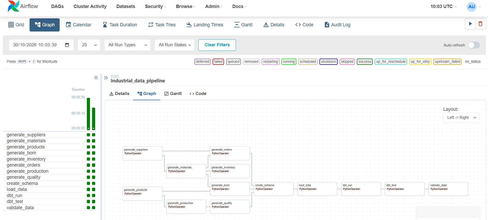
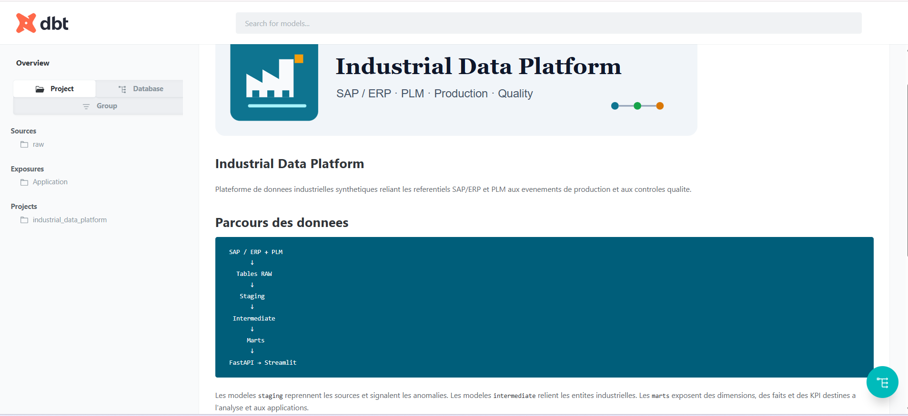
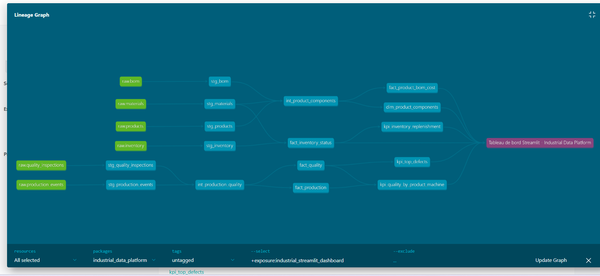
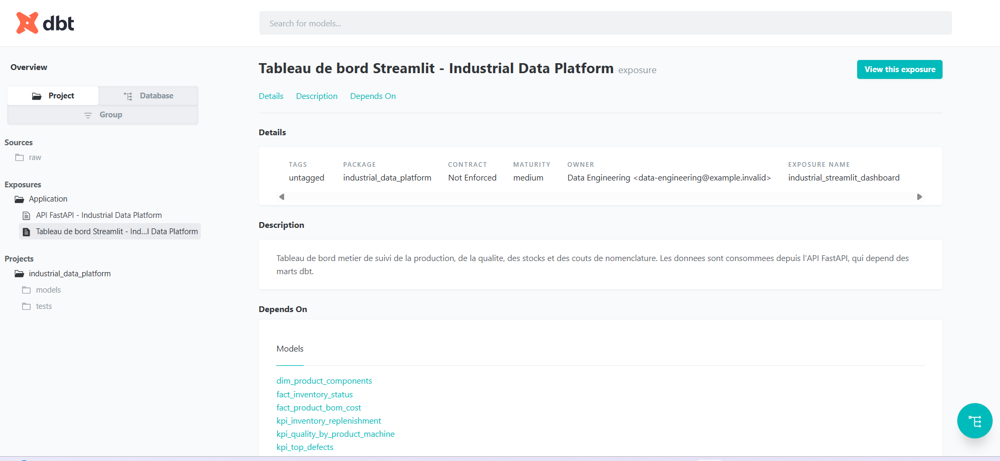

# 🏭 Industrial Data Platform

> Plateforme Data Engineering industrielle simulant l'intégration de plusieurs systèmes sources : **SAP/ERP, PLM, Production et Quality**.

Le projet reproduit une architecture Data industrielle permettant de **collecter, stocker, transformer, contrôler et exposer** des données provenant de plusieurs systèmes.

## 🏗️ Architecture

```text
┌──────────────────────────────────────────────┐
│             SOURCES INDUSTRIELLES            │
│                                              │
│  SAP / ERP   PLM   Production   Quality      │
│     │         │        │           │         │
│     └─────────┴────────┴───────────┘         │
│                    ↓                         │
│                  Airflow                     │
│              Orchestration                   │
│                    ↓                         │
│              Python / Pandas                 │
│                 Ingestion                    │
│                    ↓                         │
│              PostgreSQL 16                   │
│                    RAW                       │
│                    ↓                         │
│                   dbt                        │
│       Staging → Intermediate → Marts         │
│                    ↓                         │
│              Data Quality                    │
│                    ↓                         │
│                FastAPI                       │
│                    ↓                         │
│        Dashboards / Applications             │
└──────────────────────────────────────────────┘
```

## 🛠️ Stack

| Technologie | Rôle dans le projet |
| --- | --- |
| 🐍 Python / Pandas | Génère les sources CSV cohérentes et charge les données dans PostgreSQL. |
| 🛫 Airflow | Orchestration : génération, création du schéma RAW, ingestion et validation. Les logs, retries et statuts sont visibles dans son interface. |
| 🐘 PostgreSQL 16 | Stockage des tables sources `public` et des trois couches dbt. Une base distincte stocke les métadonnées Airflow. |
| 🔄 dbt | Transformations en trois couches : `staging`, `intermediate`, puis `marts`, avec tests d'intégrité. |
| 🚀 FastAPI | API de lecture qui expose les marts dbt aux applications sans leur donner acces direct a PostgreSQL. |
| 📊 Streamlit | Application de visualisation metier qui consomme FastAPI pour la qualite, le stock et les couts produits. |
| 🐘 pgAdmin 4 | Interface web et éditeur SQL pour explorer les tables RAW et les modèles dbt. |
| 🐳 Docker Compose | Lance l'environnement reproductible : PostgreSQL, Airflow, dbt, FastAPI, Streamlit et pgAdmin. |
| 🧪 Pytest | Tests unitaires des générateurs Python. |
| 🔁 GitHub Actions | CI/CD prévue dans une étape ultérieure du projet. |

## 📦 Sources de données

Les systèmes sources sont **simulés par des fichiers CSV** afin de reproduire une architecture industrielle multi-sources.

```text
data/
├── sap/
│   ├── suppliers.csv
│   ├── materials.csv
│   ├── inventory.csv
│   └── orders.csv
│
├── plm/
│   ├── products.csv
│   └── bom.csv
│
├── production/
│   └── production_events.csv
│
└── quality/
    └── quality_inspections.csv
```

### SAP / ERP

Données opérationnelles : matériaux, fournisseurs, stocks et commandes.

### PLM

Données produits et **BOM (Bill of Materials)**, représentant la composition des produits.

### Production

Événements de fabrication : produit fabriqué, machine, quantité et timestamp.

### Quality

Résultats des contrôles qualité : conformité, défauts et opérations de reprise.

> Les données sont générées automatiquement avec des relations métier cohérentes entre les différentes sources.

## 🧬 Génération des données

Les données synthétiques sont générées par des scripts Python afin de disposer d'un jeu de données réaliste pour le pipeline.

```text
scripts/
└── generate_data/
    ├── config.py
    ├── generate_suppliers.py
    ├── generate_materials.py
    ├── generate_products.py
    ├── generate_bom.py
    ├── generate_inventory.py
    ├── generate_orders.py
    ├── generate_production.py
    ├── generate_quality.py
    └── generate_all.py
```

Un seul script permet de générer l'ensemble des sources :

```bash
python scripts/generate_data/generate_all.py
```

La génération prend notamment en compte les **relations entre les systèmes** : produits ↔ BOM ↔ composants, commandes ↔ matériaux ↔ fournisseurs, production ↔ produits et qualité ↔ production.

## 🔄 Pipeline Data

```text
Sources
   ↓
Airflow
   ↓
Python / Pandas
   ↓
PostgreSQL RAW
   ↓
dbt
   ↓
Data Quality
   ↓
FastAPI
```

**Airflow** orchestre les différentes étapes et gère notamment les dépendances, la planification, les retries et les logs.

**Python/Pandas** réalise l'extraction et le chargement des données sources.

**dbt** transforme les données RAW en modèles exploitables et exécute les tests de qualité.

## 🧪 Data Quality

Quelques contrôles mis en place :

* `NOT NULL`
* `UNIQUE`
* relations entre tables
* valeurs acceptées
* cohérence des quantités
* validité des dates
* réconciliation avec les sources

### Quality ≠ Data Quality

**Quality** représente une donnée métier provenant d'un système industriel :

> Le produit fabriqué est-il conforme ?

**Data Quality** représente les contrôles réalisés sur notre plateforme :

> Les données intégrées et transformées sont-elles fiables et cohérentes ?

## 🗃️ Couches de données

| Schéma PostgreSQL | Contenu | Exemple |
| --- | --- | --- |
| `public` | Sources RAW chargées depuis les CSV. | `materials`, `products`, `bom`, `production_events` |
| `public_staging` | Vues dbt proches des sources, avec renommage et nettoyage minimal. | `stg_materials`, `stg_quality_inspections` |
| `public_intermediate` | Jointures métier simples. | `int_product_components`, `int_production_quality` |
| `public_marts` | Tables finales destinées à l'analyse et, plus tard, à l'API. | `dim_products`, `fact_quality`, `fact_product_bom_cost` |

FastAPI est exposee sur le port `8000` et lit uniquement les tables `public_marts`. Streamlit consomme cette API sur le port `8501`. Les mises a jour de donnees restent controlees par les sources, Airflow et dbt : l'API est volontairement en lecture seule.

## 🖼️ Captures d'ecran

### 📊 Dashboard Streamlit

Vue d'ensemble des indicateurs de production, de conformite et de reapprovisionnement :


<details>
<summary>Voir les autres pages du dashboard</summary>

#### ✅ Qualite


#### 📦 Stock


#### 💰 Produits et nomenclature BOM


</details>

### 🐘 PostgreSQL et pgAdmin

Les schémas RAW et dbt sont consultables dans pgAdmin. Les captures montrent les donnees sources, le cout de BOM et les principaux defauts :



<details>
<summary>Voir des exemples de tables et de marts</summary>

#### Table RAW des materiaux



#### Cout theorique de nomenclature



#### Indicateurs des defauts qualite



</details>

### 🛫 Airflow et 🔄 dbt Docs

Airflow rend visibles les dependances et l'execution des taches. dbt Docs presente les modeles, les applications consommatrices et leur lineage :



<details>
<summary>Voir la documentation et le lineage dbt</summary>

#### Page d'accueil de la documentation dbt



#### Graphe de lineage des donnees



#### Exposition Streamlit dans dbt Docs



</details>

## 📁 Structure du projet

```text
industrial-data-platform/
│
├── airflow/                # 🛫 Image Airflow et dépendances du scheduler
├── dags/                   # 🛫 DAG industrial_data_pipeline
├── ingestion/              # 🐍 Schéma RAW et chargement CSV → PostgreSQL
├── api/                    # 🚀 API FastAPI sur les marts dbt
├── streamlit/              # 📊 Dashboard metier consommant FastAPI
├── data/                   # 📦 Sources CSV générées (ignorées par Git)
├── dbt/                    # 🔄 Modèles staging → intermediate → marts
├── docker/                 # 🐳 Initialisation PostgreSQL et configuration pgAdmin
├── scripts/                # ⚙️ Génération des données synthétiques
├── tests/                  # 🧪 Tests unitaires Python
├── docs/                   # 📚 Documentation organisée par domaine
│   ├── data/                # Modèle, génération et qualité des données
│   └── orchestration/       # Pipeline Airflow
│
├── docker-compose.yml       # PostgreSQL, Airflow, dbt, FastAPI, Streamlit et pgAdmin
├── requirements.txt
└── README.md
```

## ▶️ Démarrage

```bash
git clone https://github.com/Ousmane-BA100/industrial-data-platform.git
cd industrial-data-platform
cp .env.example .env
docker-compose up -d --build
```

Avant le démarrage, remplacez les valeurs `replace-with-...` dans `.env`. Générez une clé Fernet avec la commande ci-dessous et copiez-la dans `AIRFLOW_FERNET_KEY` :

```bash
python -c "import secrets,base64; print(base64.urlsafe_b64encode(secrets.token_bytes(32)).decode())"
```

Gardez `.env` local : il est ignoré par Git. Pour `POSTGRES_PASSWORD`, utilisez une valeur forte composée de caractères compatibles URL, car Airflow reçoit une URL de connexion PostgreSQL construite par Docker Compose.

Vérifier que les services sont démarrés :

```bash
docker-compose ps
```

Accès aux interfaces :

| Service | URL | Identifiants |
| --- | --- | --- |
| Airflow | `http://localhost:8080` | Valeurs `AIRFLOW_ADMIN_USERNAME` / `AIRFLOW_ADMIN_PASSWORD` de `.env` |
| pgAdmin | `http://localhost:5050` | Valeurs `PGADMIN_DEFAULT_EMAIL` / `PGADMIN_DEFAULT_PASSWORD` de `.env` |
| FastAPI | `http://localhost:8000/docs` | - |
| Streamlit | `http://localhost:8501` | - |

### 1. Exécuter le pipeline Airflow

Dans Airflow, déclencher le DAG `industrial_data_pipeline`. Il exécute :

```text
Génération CSV → Création du schéma RAW → Chargement PostgreSQL
→ dbt run → dbt test → Validation finale
```

Après le succès du DAG, les marts sont prêts pour FastAPI et Streamlit. dbt est déjà exécuté automatiquement par le DAG. Pour relancer manuellement ses modèles ou ses tests :

```bash
docker-compose exec dbt dbt debug
docker-compose exec dbt dbt run
docker-compose exec dbt dbt test
```

### 2. Explorer les données dans pgAdmin

Dans pgAdmin, ouvrez la base `industrial_db`, puis **Tools → Query Tool** et exécutez :

```sql
select * from public.materials limit 10;
select * from public_staging.stg_materials limit 10;
select * from public_intermediate.int_product_components limit 10;
select * from public_marts.fact_product_bom_cost limit 10;
select * from public_marts.kpi_quality_by_product_machine limit 10;
select * from public_marts.kpi_top_defects;
select * from public_marts.kpi_inventory_replenishment limit 10;
```

### Arrêter et consulter les journaux

```bash
# Suivre les journaux d'un service
docker-compose logs -f airflow-scheduler

# Arrêter les conteneurs en conservant les volumes et donnees
docker-compose down
```

Évitez `docker-compose down -v` sauf si vous souhaitez supprimer les volumes PostgreSQL.

### Dépannage

Si Streamlit indique que l'API est indisponible :

```bash
docker-compose ps api streamlit
docker-compose logs --tail 80 api
```

Pour reconstruire uniquement l'API après une modification :

```bash
docker-compose up -d --build api
```

Si PostgreSQL ne démarre pas :

```bash
docker-compose ps postgres
docker-compose logs --tail 50 postgres
```

## 📈 Data Quality et KPI

Les tests dbt bloquants vérifient les références, les quantités positives, la chronologie
production/inspection et la cohérence entre défauts et statuts qualité. Les stocks négatifs
sont des anomalies intentionnelles : ils restent visibles dans `public_staging.stg_inventory`,
mais sont exclus de `public_marts.fact_inventory_status`.

Les marts KPI disponibles sont :

| Modèle | Indicateurs |
| --- | --- |
| `kpi_quality_by_product_machine` | Production, inspections et taux de conformité par produit/machine. |
| `kpi_top_defects` | Défauts les plus fréquents et leur taux. |
| `fact_product_bom_cost` | Quantité, nombre de composants et coût théorique de BOM par produit. |
| `fact_inventory_status` | Stock exploitable par entrepôt et seuil de réapprovisionnement. |
| `kpi_inventory_replenishment` | Matériaux à réapprovisionner, agrégés tous entrepôts. |

## 🎯 Objectif

Le projet reproduit une plateforme Data industrielle complète :

```text
INGEST
   ↓
STORE
   ↓
TRANSFORM
   ↓
TEST
   ↓
EXPOSE
```

avec plusieurs sources, orchestration batch, transformation, Data Quality et exposition via API.
